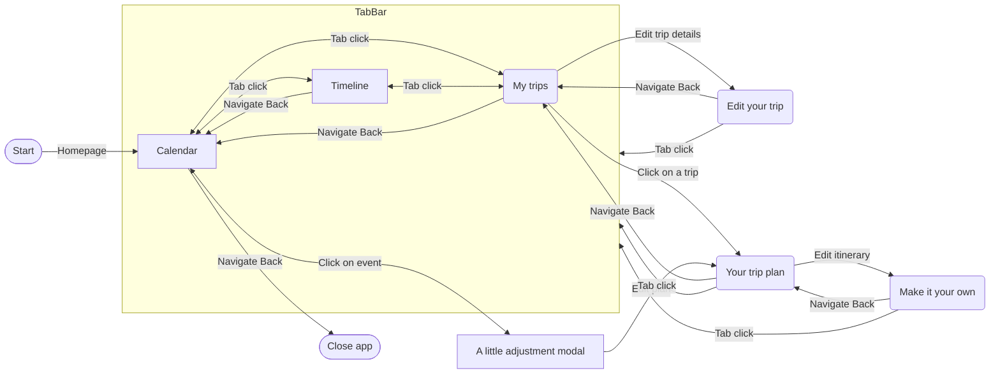

# EzMyGo

**Easy does it. Let's go.** An offline-first travel planner built with React, TypeScript, Vite, and VitePWA.

App name, tagline, and page metadata are centralized in `src/config.ts`.

```powershell
yarn
yarn dev
```

The app is usable without an account and stores trips and plans in browser local storage. To connect the sync service, start the API and use **Sync now** to register or sign in. Set `VITE_API_URL` in a `.env` file when the API is hosted somewhere other than `http://localhost:8000`.

```powershell
yarn build
yarn preview
```

## Navigation diagram (not implemented yet)


